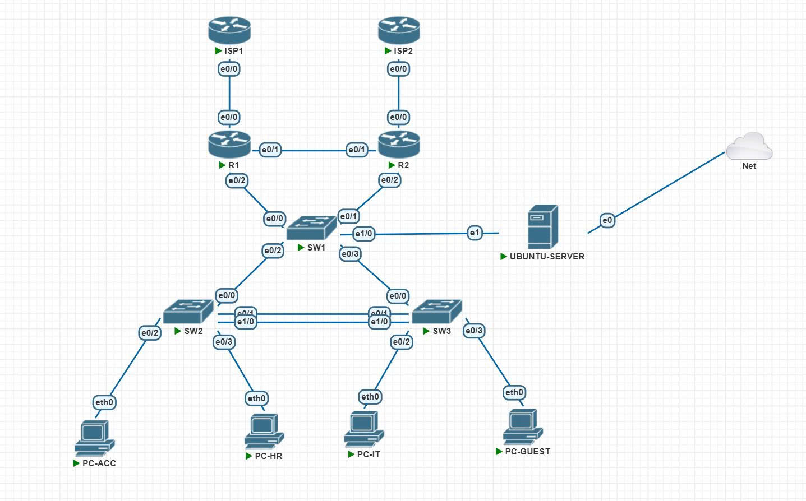
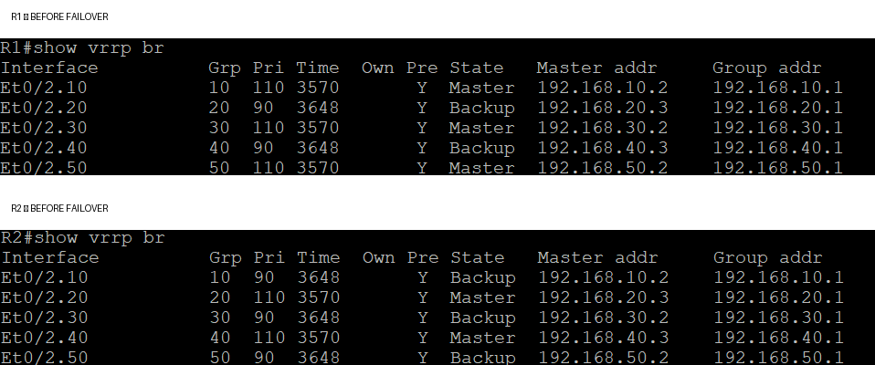
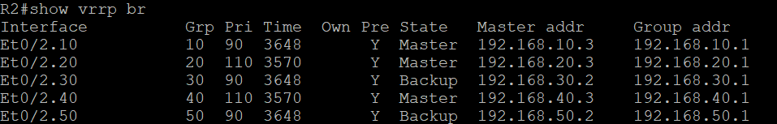
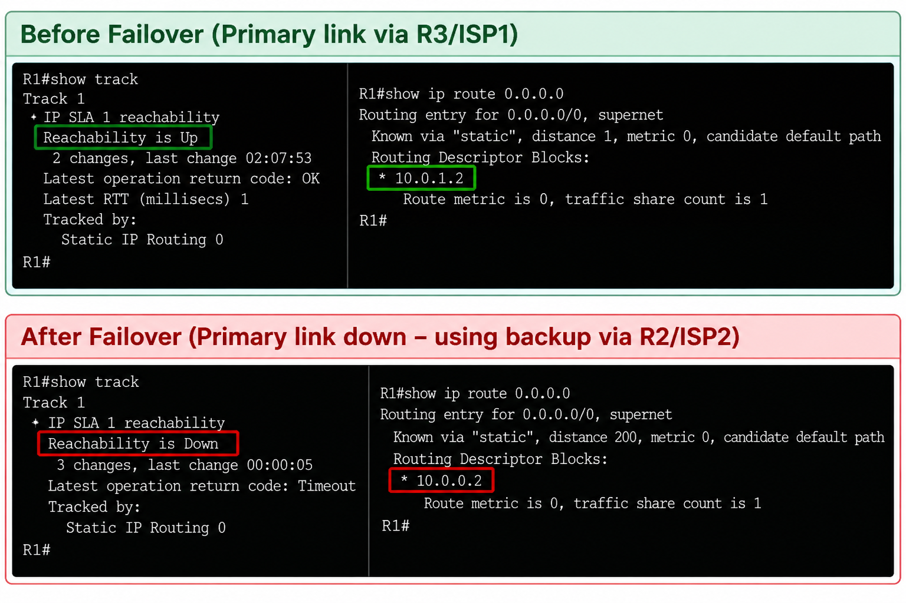

# Enterprise Network Design & Troubleshooting Lab

**Type:** Personal networking lab  
**Environment:** PNETLab, Cisco IOS, Ubuntu Server 24.04, Nginx  
**Focus:** Routing & switching, redundancy, access control, and troubleshooting

## 1. Project Overview

This project simulates a small enterprise network with multiple VLANs, redundant gateways, redundant WAN paths, and an internal web server. It was built as a hands-on learning project while preparing for Cisco CCNA and practicing network troubleshooting.

The lab focuses on configuration and verification rather than production deployment.
## 2. Network Topology

## 3. Key Implementations

- **VLANs and Inter-VLAN Routing:** Segmented the network into Accounting, HR, IT, Guest, and Server VLANs.
- **VTP and Trunking:** Configured VLAN propagation and trunk links between switches.
- **EtherChannel:** Bundled switch links using LACP for link redundancy.
- **VRRP:** Configured redundant default gateways across VLANs.
- **Routing:** Implemented static routing and OSPF.
- **WAN Redundancy:** Configured dual ISP paths, floating static routes, IP SLA, and object tracking.
- **DHCP:** Configured dynamic IP address assignment for user VLANs.
- **Extended ACLs:** Restricted inter-VLAN traffic and controlled access to the internal web server.
- **Linux Web Server:** Deployed Ubuntu Server 24.04 with Nginx.

## 4. Testing and Verification

- Verified DHCP address assignment for client VLANs.
- Tested inter-VLAN access policies using ping and TCP port checks.
- Verified HTTP access to the internal web server on TCP port 80.
- Tested VRRP gateway failover.
- Tested WAN failover using IP SLA and floating static routes.
- Used Cisco `show` commands and ACL counters to troubleshoot connectivity.

## 5. Troubleshooting Experience

- **VRRP Failover:** Verified gateway availability after changing the active router state.
- **WAN Failover:** Simulated primary ISP failure and verified backup routing using IP SLA and floating static routes.
- **ACL Troubleshooting:** Used ACL hit counters and connectivity tests to identify permitted and denied traffic.
- **Server Connectivity:** Verified HTTP access to the Ubuntu Nginx server and investigated routing and access-control issues.
- **Return-Path Analysis:** Learned to check both forward and return traffic paths when troubleshooting connectivity across VLANs.

## 6. Tools and Technologies

- Cisco IOS
- PNETLab
- Ubuntu Server 24.04
- Nginx
- VLAN, VTP, 802.1Q trunking, LACP
- VRRP, OSPF, static routing, IP SLA
- DHCP, Extended ACLs

## 7. VLAN and IP Addressing Plan

| VLAN | Purpose | Subnet | Default Gateway (VRRP VIP) |
|---|---|---|---|
| 10 | Accounting | `192.168.10.0/24` | `192.168.10.1` |
| 20 | HR | `192.168.20.0/24` | `192.168.20.1` |
| 30 | IT | `192.168.30.0/24` | `192.168.30.1` |
| 40 | Guest | `192.168.40.0/24` | `192.168.40.1` |
| 50 | Server | `192.168.50.0/24` | `192.168.50.1` |

**Ubuntu Web Server:** `192.168.50.10/24`  
**WAN/transit links:** Separate point-to-point subnets are used between routers and ISP simulation routers.

## 8. Access-Control Policy

The lab uses extended ACLs to practice least-privilege access between VLANs. Examples include:

- Guest traffic is restricted from reaching internal user and server VLANs while internet-simulation access is tested.
- Accounting and HR are allowed to access the Ubuntu server over HTTP/HTTPS by ACL policy; other traffic to the server subnet is restricted according to the configured rules.
- IT is allowed to reach the Ubuntu server on TCP ports 80 and 443, while other traffic from IT to the server subnet is denied by the lab ACL.

**Note:** ACLs are stateless. Return traffic and management protocols must be considered when designing and testing policies. HTTPS access was permitted by ACL, but the lab verification confirmed the Nginx HTTP service on TCP port 80; HTTPS service operation was not confirmed.

## 9. Validation and Troubleshooting

The following behaviors were tested during the lab:

- Verified DHCP address assignment for client VLANs.
- Tested inter-VLAN connectivity against the configured ACL policies.
- Verified HTTP access to the Ubuntu Nginx server at `192.168.50.10`.
- Checked ACL hit counters to identify permitted and denied traffic.
- Tested VRRP gateway failover.
- Tested WAN failover using IP SLA and floating static routes.
- Verified connectivity to simulated ISP loopback destinations.

### Example Troubleshooting Workflow

1. Check interface status using `show ip interface brief`.
2. Verify VRRP state using `show vrrp brief`.
3. Inspect route selection using `show ip route`.
4. Check ACL entries and hit counters using `show access-lists`.
5. Test connectivity hop by hop, from the client gateway to the server or WAN destination.
6. Compare routing, ACL policy, and service availability to isolate the cause of a failure.
The following behaviors were tested during the lab:

## 10. Key Learning Outcomes

- Practiced combining routing, switching, redundancy, and ACLs in one multi-VLAN topology.
- Learned to verify failover behavior rather than relying on configuration alone.
- Investigated how independent VRRP groups can have different Master routers and how this may affect return paths.
- Used ACL counters and targeted connectivity tests to narrow down network issues.

## 11. Lab Scope and Limitations

- This is a personal simulation lab, not a production enterprise deployment.
- The ISP routers and public-looking loopback addresses are simulated inside the lab.
- HTTP was tested on TCP port 80. HTTPS service operation was not verified.
- Configuration details may vary depending on the Cisco IOS image and PNETLab node type.

## 12. Disclaimer

All addresses, devices, and services in this repository are used for an isolated educational lab. Do not upload passwords, private keys, real customer configurations, or sensitive information.

## 13. Network Failover Verification

### 1. VRRP Gateway Redundancy

This test verifies that R2 takes over as the Master gateway for VLAN 10 when the R1 VLAN 10 subinterface goes down.

**Before failover — R1 and R2**

**After failover — R2 becomes Master for VLAN 10**

### 2. WAN Failover Using IP SLA

IP SLA monitors reachability to `8.8.8.8`. When the primary path through ISP1 becomes unavailable, R1 selects the floating static route through R2.

**Before and after failover**

